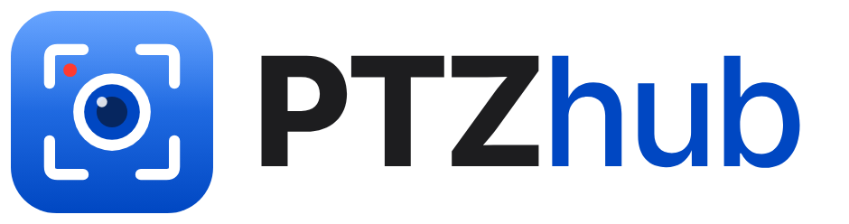

<p align="center">
  <picture>
    <source media="(prefers-color-scheme: dark)" srcset="docs/img/logo-dark.png">
    
  </picture>
</p>

<p align="center">
  <b>Free PTZ camera controller for network cameras</b><br>
  VISCA over IP · ONVIF · OBS dock · Stream Deck · macro keyboards — Windows &amp; macOS
</p>

<p align="center">
  <a href="https://github.com/Redmango-Agency/PTZhub/releases/latest"><b>Download</b></a> ·
  <a href="#features">Features</a> ·
  <a href="#supported-cameras">Cameras</a> ·
  <a href="#install">Install</a> ·
  <b>English</b> · <a href="README.it.md">Italiano</a>
</p>

<p align="center">
  
  
  
  <a href="https://redmango.agency/?utm_source=github&amp;utm_medium=referral&amp;utm_campaign=ptzhub"></a>
</p>

PTZ Hub gives you live preview, joystick, zoom and focus, and **presets** you recall with one click or one key. Built for events, conferences, churches and live streaming. *(Up to version 1.3 the program was called PTZ Panel.)*

## Features

- **Presets with a dedicated editor**: "+ New preset" opens the editor with preview and controls; position the camera and save. The exact coordinates (pan, tilt, zoom, focus) read from the camera are stored, plus a thumbnail. On recall the head goes back exactly there.
- **Separate presets for every Windows / macOS account**, with export and import.
- **Fast recall**: click the thumbnail, keys `1`–`9` and `0`, or global shortcuts that also work with OBS, vMix or PowerPoint in front.
- **Live preview** over RTSP (ffmpeg included) or USB, rule-of-thirds grid, 180° rotation for ceiling mounts.
- **Manual control**: proportional joystick, arrow keys (Shift = slow), zoom, auto/manual focus, Home, **STOP** (`Esc` or `Space`).
- **Made for live shows**: always-on-top window, safety stop on release, on focus loss and on quit; a recall in progress is interrupted by STOP.
- **Reduced views**: **Compact** column always on top, or a **Side** tab docked to the left or right edge of the screen that opens on mouse hover.
- **Automatic discovery**: finds cameras on the network (ONVIF WS-Discovery + scan), detects the protocol and the video stream address.
- **Hub for OBS, Stream Deck and macro keyboards**: a dock for OBS, a web address for every function (Stream Deck, Bitfocus Companion), global keys for every function, and a **Stream Deck plugin** with thumbnails, names and an "on air" light on the keys. Everything goes through the program, so all of them show the same active preset. Details in [docs/comandi-esterni.md](docs/comandi-esterni.md) (Italian).
- **Italian and English**, chosen automatically from the system language.

## Supported cameras

PTZ cameras controlled over the network with standard protocols:

| Protocol | Typical port | Brands |
|---|---|---|
| VISCA over IP (UDP) | 1259 | Tenveo, PTZOptics, AViPAS, BZBGear, Minrray and clones |
| VISCA over IP (TCP) | 5678 | as above |
| Sony VISCA over IP | 52381 | Sony SRG/BRC and compatible |
| ONVIF PTZ | 80 / 8000 / 8080 | many IP and PTZ cameras |

If the camera can't report its position, presets use the camera's internal memories (each account on a different range).

**Not supported yet**: cameras controlled only through RS-232/RS-485 serial, Panasonic AW (proprietary HTTP), USB-only PTZ webcams (USB cameras work for the preview, not for moving the head).

Support is being field-tested: if you try it with your model, open an [issue](https://github.com/Redmango-Agency/PTZhub/issues/new/choose) ("Camera tested").

## Install

### Windows
1. Download `…-Setup-<version>.exe` from [Releases](https://github.com/Redmango-Agency/PTZhub/releases).
2. Run it: it installs for all accounts on the PC, creates shortcuts and opens the firewall for the camera.
3. Windows may warn that the program isn't signed: "More info" → "Run anyway".

A portable version (`…-portable-win-x64.zip`) is also available.

### Mac (beta)
1. Download `…-mac-arm64.dmg` for Apple Silicon (M1–M4) or `…-mac-x64.dmg` for Intel Macs.
2. Open the dmg and drag the app to Applications.
3. The app isn't signed by Apple yet: the first time, open Terminal and paste
   `xattr -cr "/Applications/PTZ Hub.app"` (for versions up to 1.3: `"/Applications/PTZ Panel.app"`),
   otherwise macOS says the app "is damaged".
4. On the first camera search allow access to the local network.

### Stream Deck
1. Download `PTZ-Hub.streamDeckPlugin` from [Releases](https://github.com/Redmango-Agency/PTZhub/releases) and double-click it.
2. In PTZ Hub › Settings › External control copy the OBS panel address and paste it into any PTZ Hub key in Stream Deck: host, port and key are filled in for you.
3. Drag "Preset" and "Command" keys onto the deck. Details: [streamdeck/README.md](streamdeck/README.md) (Italian).

### Updates
At startup and then once a day the program asks GitHub for the latest published version. If there's a newer one, a "Download" notice appears at the top and opens the release page: the program never downloads or installs anything by itself, so nothing changes during an event. You can turn the check off in Settings.

## Getting started
1. On first start the program searches the network and suggests the camera (or type its IP).
2. Video preview: it finds the RTSP stream; choose USB if the camera is connected to this computer.
3. "+ New preset" to create your shots.

## Development
Node.js 22.

```bash
npm install
npm run ffmpeg:win      # ffmpeg for the Windows package (not in the repository); Mac: node scripts/fetch-ffmpeg.js darwin-arm64
npm start
npm test                # protocols with simulated cameras (VISCA, ONVIF), external control, updates
npm run dist:win        # installer and portable version in dist/
```

GitHub Actions builds the Windows installer, the Mac dmgs and the Stream Deck plugin on every `v*` tag and publishes them in Releases, with the notes taken from the changelog. The plugin lives in [streamdeck/](streamdeck/). See [CHANGELOG.md](CHANGELOG.md) and [CONTRIBUTING.md](CONTRIBUTING.md).

```
src/main/      camera drivers (visca.js, onvif.js), discovery, preview, per-account storage,
               hub.js (command hub), control.js (local API for OBS/Stream Deck), updates.js
src/renderer/  user interface          src/control/  OBS dock
src/shared/    Italian and English texts          test/  simulated cameras and tests
build/         icons, installer and packaging scripts
```

## Security
Vulnerabilities: report them privately, see [SECURITY.md](SECURITY.md).

## Credits
PTZ Hub is designed and developed by [**\*redmango**](https://redmango.agency/?utm_source=github&utm_medium=referral&utm_campaign=ptzhub), a digital studio in Turin, Italy: websites and apps, advertising, AI systems and automation.
Need a custom version, an integration with your production setup or support for another camera? Get in touch through [redmango.agency](https://redmango.agency/?utm_source=github&utm_medium=referral&utm_campaign=ptzhub).

## License
[MIT](LICENSE) © Redmango S.r.l. — free to use, modify and redistribute, including commercial use.

The packages include FFmpeg (GPL v3) as a separate program for the video preview, and Electron/Chromium: see [THIRD_PARTY_NOTICES.md](THIRD_PARTY_NOTICES.md).
